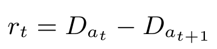

## Reward

The default reward function is the change in cumulative vehicle delay:

<p align="center">

</p>

That is, the reward is how much the total delay (sum of the waiting times of all approaching vehicles) changed in relation to the previous time-step.

You can choose a different reward function (see the ones implemented in [TrafficSignal](https://github.com/LucasAlegre/sumo-rl/blob/main/sumo_rl/environment/traffic_signal.py)) with the parameter `reward_fn` in the [SumoEnvironment](https://github.com/LucasAlegre/sumo-rl/blob/main/sumo_rl/environment/env.py) constructor.

The following reward functions are available out of the box (pass the name as `reward_fn`):

- `diff-waiting-time` (default): change in the total waiting time of the approaching vehicles
- `average-speed`: average speed of the vehicles in the incoming lanes, normalized by the allowed speed
- `queue`: negative total number of queued vehicles
- `pressure`: number of vehicles leaving minus the number of vehicles approaching the intersection
- `co2`: negative total CO2 emissions of the vehicles in the incoming lanes

It is also possible to implement your own reward function:

```python
def my_reward_fn(traffic_signal):
    return traffic_signal.get_average_speed()

env = SumoEnvironment(..., reward_fn=my_reward_fn)
```
